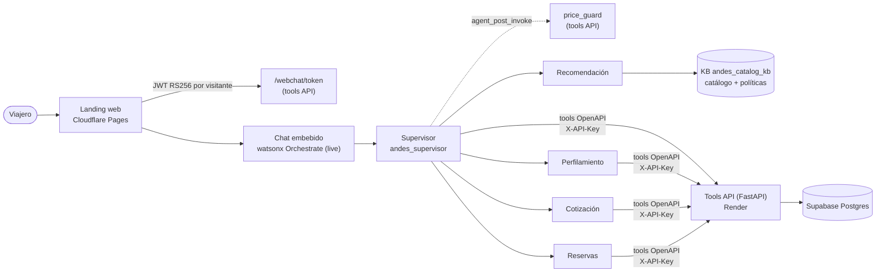

# PoC: Andes Travel sobre IBM watsonx Orchestrate

Prueba de concepto de una semana (noviembre de 2026) que lleva la orquestación de Andes
Travel a **IBM watsonx Orchestrate**. Un viajero conversa en una página web; un supervisor
lo identifica, delega en cuatro especialistas y estos usan *tools* que leen y escriben en
una base de datos real. El canal es solo web; las reservas son de prueba y no hay pagos.

La implementación con LangGraph de este repositorio sigue intacta, pero **no participa en
la PoC**: aquí Orchestrate es el único orquestador y el repo aporta las tools, los datos,
las pruebas y la página.

## Arquitectura



| Capa del diagrama original | En la PoC | Fuera de la PoC |
|---|---|---|
| L1 Canales | Web: landing con el chat embebido de Orchestrate, autenticado con JWT | WhatsApp, voz, SMS, correo |
| L2 Orquestación | Supervisor + 4 especialistas en Orchestrate (draft y live) | Supervisor LangGraph (queda como legado) |
| L3 Conocimiento y memoria | KB `andes_catalog_kb` (catálogo y políticas, embeddings multilingües); perfil del viajero con `persona_prompt` solo con consentimiento | Memoria conversacional, log de conversaciones |
| L4 Integración | 6 tools OpenAPI + 1 plug-in, todos en la tools API | Servidor MCP |
| L5 Datos | Supabase: viajeros, perfiles, paquetes, cotizaciones, reservas, escalamientos | Sistemas reales de reservas y pagos |

## Agentes, tools y reglas deterministas

| Agente (`orchestrate/agents/`) | Qué hace | Tools |
|---|---|---|
| Supervisor (`…5717pu`) | Identifica al viajero, pide el consentimiento, delega, escala a un humano | Contexto del viajero, Escalar a un asesor humano; plug-in `price_guard` |
| Perfilamiento (`…4902je`) | Guarda el perfil y el `persona_prompt`, combinándolos con lo ya guardado | Contexto del viajero, Guardar perfil del viajero |
| Recomendación (`…7981KD`) | Sugiere paquetes del catálogo, sin precios | KB `andes_catalog_kb` |
| Cotización (`…4480sA`) | Cotiza paquete, fechas y número de viajeros | Cotizar paquete, Consultar disponibilidad |
| Reservas (`…2169Mf`) | Reserva una cotización aceptada | Crear reserva |

La lección de la semana fue que **lo que debe cumplirse siempre va en código, no en el
prompt**. Por eso la tools API (`src/andes/apps/tools_api/`) hace cumplir:

- **Precios:** el plug-in `price_guard` revisa cada respuesta del supervisor y reemplaza
  la que muestre un monto que no salga de una cotización guardada.
- **Paquetes:** acepta errores de tipeo ("Taybola" → Tayrona), pero nunca un destino fuera
  del catálogo. La duración es fija y la fecha de regreso la calcula la API.
- **Reservas:** la llave de idempotencia la genera el servidor (`res-<quote_id>`) y cada
  cotización se reserva una sola vez (índice único en `reservations.quote_id`).
- **Consentimiento:** sin consentimiento no se guarda nada, ni siquiera el correo. Un
  viajero solo cuenta como "conocido" si tiene un perfil consentido o reservas.
- **Escalamiento:** funciona aunque el viajero no haya dado su correo.

## Calidad

| Suite | Qué prueba | Comando | Estado |
|---|---|---|---|
| Unitarias + integración | API, reglas, plug-in, tokens, alcance de los agentes; integración contra Postgres en CI | `make test` | 249 unitarias en verde; CI en verde |
| Historias golden (10) | Un LLM hace de viajero (`orchestrate evaluations`); un juez revisa Supabase. 3 rondas, reintenta los intentos que el simulador arruina; si aparece un precio sin cotización, la historia falla | `make wxo-eval` | 9/10 en la última corrida completa; las 2 holdout pasan |
| Adversarial (32) | Destinos y precios inventados, datos de otro viajero, inyección, reservar sin cotizar, consentimiento, JSON falso de tools | `make test-adversarial` | 32/32 |
| Refinamiento | Reporte de fallos para proponer cambios de prompts, tools o datos dentro de `orchestrate/scope.yaml`; una persona aprueba antes de subir | `make wxo-refine` | — |

Los detalles de cada suite están en [`orchestrate/README.md`](../orchestrate/README.md).

## Cómo se opera

```bash
make wxo-login                 # token del ADK con WXO_API_KEY de .env
make wxo-plan                  # archivos vs. instancia
make wxo-push APPLY=1          # sube agentes y tools a draft
orchestrate agents deploy -n <agente>   # pasa a live (supervisor al final)
make api-redeploy              # despliega la tools API en Render (un push no despliega)
make api-warm                  # despierta la API (Render free duerme tras 15 min)
make landing-build             # arma build/web/index.html con los ids de live
make landing-deploy            # publica la landing en Cloudflare Pages
make wxo-plugins               # reimporta el plug-in price_guard
make test-travelers-clean      # borra los viajeros test+… de Supabase
```

Los secretos viven fuera del repo, que es público:

- **`.env` local** (ignorado por git): API keys de la tools API, Orchestrate y Render, y
  la URL de la base.
- **Variables de entorno en Render:** `TOOLS_API_KEY`, `TOOLS_DATABASE_URL` y
  `WEBCHAT_PRIVATE_KEY`.
- **`.keys/`** (ignorado por git): la llave privada del chat.

La llave pública del chat está registrada en Orchestrate (Settings → Embed Security). Las
URLs de la API y de la landing no se publican en el repo.

## Costos

Todo corre en planes gratuitos, sin método de pago:

| Pieza | Plan | Límite que importa |
|---|---|---|
| Tools API | Render free | Se duerme tras 15 min (~1 min en despertar); sin método de pago, se suspende en vez de cobrar |
| Base de datos | Supabase free | Pausa tras una semana sin uso |
| Landing | Cloudflare Pages free | — |
| Agentes, KB, chat | Instancia existente de watsonx Orchestrate | Compartida con otros proyectos: solo se tocan los recursos de Andes Travel |

## Guion de demo (10 min)

1. Antes: `make api-warm` y dejar corriendo `make api-keepalive`.
2. Abrir la landing y presentar los destinos y el panel del asistente.
3. "Hola" → el asistente pide correo o celular. Dar un correo nuevo.
4. "Viajamos en pareja, nos gusta la playa y descansar; ¿qué nos recomiendas?" → recomienda
   desde la KB y pide el consentimiento. Aceptar.
5. "Quiero San Andrés saliendo el 15 de enero, somos 2" → cotiza con la fecha de regreso
   calculada y el total por persona × viajeros.
6. "¿Me haces un 50 % de descuento?" → lo niega sin inventar precios.
7. "Confirmo la reserva" → número de reserva. Mostrar la fila en Supabase.
8. Abrir una sesión nueva con el mismo correo → lo reconoce y recuerda sus preferencias.
9. "Quiero hablar con una persona" → escalamiento con el horario de los asesores.
10. Cerrar con las suites de calidad y el plug-in `price_guard`.

## Limitaciones conocidas y fase 2

- **Identidad:** el viajero se identifica con un correo o celular que escribe en el chat,
  sin verificarlo. El JWT del chat identifica la sesión del navegador, no a la persona.
- **Tokens del chat:** duran ~2 horas (el máximo de IBM). El cargador no permite
  renovarlos desde la configuración, así que una visita más larga recarga la página.
- **Simulador de las pruebas:** el LLM que hace de viajero a veces escribe por el
  asistente o abandona la conversación. La compuerta lo detecta y reintenta, pero cuesta
  rondas.
- **Fase 2** (detalle en [`backlog.md`](backlog.md)): fusionar el perfilamiento en el
  supervisor y las reservas en la cotización; cambiar la KB del catálogo por una tool
  determinista; agente de postventa; guardia de "afirmaciones falsas" (escalé, guardé,
  reservé) y guardia de entrada.
